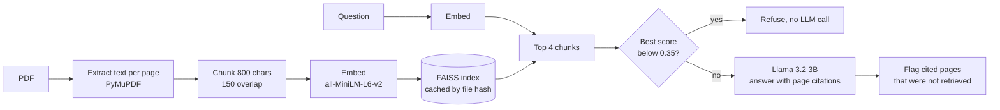

# SpecSeek

Ask questions about electronic component datasheets and get answers with page citations.

Upload a datasheet PDF, ask something like "What PWM resolutions does Timer1 support?", and get a short answer that cites the pages it came from. Everything runs locally: a small embedding model for search and Llama 3.2 3B through Ollama for answers. No API keys, nothing leaves your machine.

## Setup

Requirements: Python 3.11+ and [Ollama](https://ollama.com/download).

```bash
# 1. get the local LLM (about 2 GB)
ollama pull llama3.2:3b

# 2. install the project
git clone https://github.com/agarwalnishi/SpecSeek.git
cd SpecSeek
python -m venv .venv
source .venv/Scripts/activate   # Windows (Git Bash); on macOS/Linux: source .venv/bin/activate
pip install -r requirements.txt

# 3. run the API
uvicorn app.main:app --reload
```

The first start downloads the embedding model (about 90 MB). After that it loads from the local cache.

## Usage

Open http://localhost:8000/docs for an interactive page where you can try every endpoint.

**1. Upload a datasheet**
```bash
curl -F "file=@datasheets/atmega328p.pdf" http://localhost:8000/upload
```
```json
{"doc_id": "fb84858d...", "filename": "atmega328p.pdf", "chunks": 1084, "cached": false, "seconds": 41.3}
```
The `doc_id` is the file's SHA-256 hash. Uploading the same file again (even renamed) loads the saved index instantly.

**2. Ask a question**
```bash
curl -X POST http://localhost:8000/ask \
  -H "Content-Type: application/json" \
  -d '{"doc_id": "fb84858d...", "question": "What is the PWM resolution in phase correct PWM mode?"}'
```
```json
{
  "answer": "The PWM resolution in phase correct PWM mode can be fixed to 8-, 9-, or 10-bit, or defined by either ICR1 or OCR1A ... (Page 103)",
  "pages": [103, 104],
  "unverified_citations": [],
  "refused": false,
  "top_score": 0.716,
  "seconds": 40.13
}
```

| Endpoint | What it does |
|---|---|
| `GET /health` | Status and configured models |
| `POST /upload` | Index a PDF (or load it from cache), returns `doc_id` |
| `POST /ask` | Answer a question about an uploaded PDF |

Errors: `400` not a PDF or no text in it, `404` unknown document, `422` invalid input, `503` Ollama not running.

## Tests and evaluation

```bash
pytest -q                  # 35 tests, ~13 s, no Ollama needed (the LLM is mocked)
python -m eval.run_eval    # retrieval hit rate and refusal check on the ATmega328P datasheet
```


## How it works



- **Extraction** keeps true page numbers, normalizes whitespace, and skips pages with no text.
- **Chunking** works per page, so every chunk maps to exactly one page for citations. Tiny scraps (footers) and table of contents chunks are dropped, since they match on keywords but contain no information.
- **Search** uses normalized 384-dim embeddings in a FAISS inner-product index, which equals cosine similarity.
- **Cache:** the index and chunks are saved under `cache/<sha256>/`, so re-uploads and server restarts skip re-indexing.
- **Answering:** if even the best chunk is below the similarity threshold, the API refuses without calling the LLM. Otherwise Llama 3.2 3B answers from the retrieved excerpts only (temperature 0). Any cited page that was not in the retrieved set is returned in `unverified_citations`.

```
app/
  config.py    all settings in one place
  extract.py   PDF to page texts
  chunk.py     overlapping per-page chunks, TOC filter
  index.py     embeddings, FAISS index, search
  cache.py     SHA-256 file hash, save/load index
  llm.py       prompt, Ollama call, threshold refusal, citation check
  main.py      FastAPI endpoints
tests/         35 pytest tests (generated sample PDF, mocked LLM)
eval/          25-question eval set and hit-rate script
```

## Results

Evaluated on the ATmega328P automotive datasheet (294 pages) with 25 questions written for this project, each checked against the page(s) that contain the answer.

**Chunk size vs retrieval hit rate@4** (overlap 150):

| Chunk size | Chunks | Hit rate@4 |
|---|---|---|
| 400 | 2577 | 64% (16/25) |
| **800** | **1084** | **76% (19/25)** |
| 1200 | 722 | 64% (16/25) |

Smaller chunks split answers from their headings (watchdog table, I2C speed, sleep modes). Larger chunks mix too many topics into one vector. 800 is used by default.

**Refusals at threshold 0.35:**
- Unrelated questions (cricket, Python install, geography) scored 0.13 to 0.19 and were refused before the LLM.
- Same-domain questions about other hardware (STM32 ADC 0.556, Raspberry Pi clock 0.468) passed the threshold, but the LLM prompt refused both. End to end: 5/5 refused.
- Real datasheet questions wrongly refused: 0/25.

**Speed** on an 8 GB RAM laptop (Intel i5-1335U, no dedicated GPU):

| Step | Time |
|---|---|
| Index a 294-page datasheet | ~30 to 50 s |
| Load from cache | 0.03 to 0.1 s |
| Answer a question | ~25 to 40 s |
| Server startup | ~10 s |

Llama 3 8B was tried first but took 30 to 90 s per short answer because it did not fit comfortably in 8 GB of RAM. Llama 3.2 3B fits and is several times faster.


## Limitations

- **Spec summary pages retrieve poorly.** The page 1-2 Features list packs dozens of specs into each chunk, so its embedding matches nothing strongly. Most of the remaining eval misses (voltage range, PWM count, timer count, write endurance) are here.
- **Number-only tables** (like the brown-out level table) give the embedding model little text to match.
- **No OCR:** scanned PDFs are rejected with a 400. Some symbols (for example ×) are lost during text extraction.
- **The citation check catches invented page numbers, not wrong facts on real pages.** An answer can cite a correct page and still leave out details.
- **Temperature 0 is not fully deterministic** on CPU; repeated runs can word answers differently.
- **Single process, local use:** loaded documents live in memory (rebuilt from the disk cache after a restart), and uploaded files are kept in `uploads/` indefinitely.
- **The eval is small:** one datasheet and 25 questions. Treat the numbers as a sanity check, not a benchmark.

## Next steps

- **Hybrid search (BM25 + embeddings)** so exact terms like "PWM channels" or "brown-out" can match spec lists and tables directly
- Table-aware extraction for register and electrical characteristic tables
- OCR for scanned datasheets
- Streaming answers so the first words appear before the full 25 to 40 s
- Evaluate on more datasheets (an STM32 or ESP32 part) to check the chunk size choice generalizes